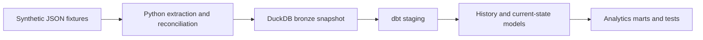

# Issue Tracker Lakehouse

[](https://github.com/panmichalakos-unity/issue-tracker-lakehouse/actions/workflows/ci.yml)

A small, runnable data engineering project that turns synthetic issue-tracker events into tested analytics tables using **Python, DuckDB and dbt**.

The project demonstrates reliable ingestion, incremental merging, history modelling and point-in-time joins. It runs locally with invented fixtures, without API credentials or cloud infrastructure. This is an independently written personal portfolio project; the fixtures are synthetic.

## What you can explore

- **Adaptive extraction:** split busy date windows into smaller intervals and batch projects by estimated size.
- **Stable issue identity:** merge on immutable issue ID, including when an issue changes project or key.
- **Incremental updates:** read per-project watermarks from the existing snapshot, apply a lookback and retain unchanged rows.
- **Safe publication of data:** validate expected issue IDs before writing, then commit all bronze tables in one transaction.
- **Recovery by replay:** failed extraction or a failed database write preserves the previous snapshot. Running the same extraction again is safe.
- **Analytics engineering:** staging, intermediate and mart models with explicit grains, dbt tests, status history and group-membership validity intervals.



## Quick start

Use **Python 3.12**. Run the following from the repository root.

```bash
git clone https://github.com/panmichalakos-unity/issue-tracker-lakehouse.git
cd issue-tracker-lakehouse
python -m venv .venv
```

Activate the environment:

```powershell
# Windows PowerShell
.\.venv\Scripts\Activate.ps1
```

```bash
# macOS / Linux
source .venv/bin/activate
```

Then install and run:

```bash
python -m pip install -r requirements.txt
python scripts/run_demo.py
```

The demo script runs Python tests, a fresh snapshot and dbt build, another snapshot, an incremental update and another dbt build. It verifies that **34 issues remain after repeated runs**. The same script runs in GitHub Actions on Windows and Linux with Python 3.12.

Dependencies are pinned through `requirements.txt` and `constraints.txt`. Those pins record a tested package set; they are not a hash-verified package lock. Initial installation requires internet access. The fixture pipeline itself does not access Jira or another external data API. The demo script disables dbt anonymous usage statistics.

### Run individual steps

```bash
python -m pytest -q
python -m ingest
python -m ingest --incremental
cd dbt
dbt build --profiles-dir .
```

Run a full snapshot before the first incremental update. Keep `dbt build` in the `dbt/` directory: its local profile points at `../data/warehouse.duckdb`. Return to the repository root before running Python ingestion commands.

## Expected outputs

The script creates `data/warehouse.duckdb` and an informational `data/manifest.json` receipt. Generated data, logs and compiled dbt artifacts are ignored by Git.

| Output | Grain / expected result |
|---|---|
| `bronze.issues` | 34 current issues, one row per immutable ID |
| `bronze.changelog` | 4 synthetic change events |
| `marts.fct_issues` | One row per issue |
| `intermediate.int_issue_status_history` | One row per observed status interval |
| `intermediate.int_group_membership_scd2` | Account, group and validity window |
| `marts.fct_comment_with_group_at_time` | Comment with group membership at the comment timestamp |
| `marts.fct_epic_health_violations` | One row per epic and rule violation |

The synthetic examples include an issue moving between projects, an account leaving a group, and epics with missing ownership, missing due dates or stale activity. Alice's February comment belongs to the ops group; her April comment does not.

The fixture clock is fixed at **15 June 2024**, so time-based results remain reproducible. All stored event timestamps use UTC.

## Reliability model

Full runs reconstruct the snapshot from the fixtures. Incremental runs merge changed issues by ID, changelog events at their event grain and comments by comment ID into the existing snapshot. Complete fixture snapshots supply sprints and group-membership history on each run.

Before replacing any tables, ingestion compares the proposed issue-ID set with the complete expected fixture-ID set. DuckDB then writes the bronze tables inside a single transaction. A failed insert rolls back the replacement.

The manifest is written atomically **after the database commits**. It is a receipt, not a checkpoint: it never causes projects to be skipped. If receipt writing fails, data may already be committed; rerunning safely replays the extraction and repairs the receipt. A failed run does not resume halfway through a project.

Tests exercise repeated runs, interrupted extraction, failed database writes, receipt failures, corrupt/old receipts, exact-ID reconciliation, overlapping windows, unchanged rows, UTC timestamp stability and moved-issue identity.

## Project layout

```text
ingest/             Fixture client, extraction, merging and transactional writes
fixtures/           Invented issues, projects, comments, sprints and memberships
dbt/models/         Staging, intermediate and mart SQL models
dbt/tests/          Business and history-validity assertions
tests/              Python algorithm and failure-recovery tests
scripts/run_demo.py End-to-end verification entry point
docs/design.md      Data grains, tradeoffs and extension points
```

## Scope and tradeoffs

This is an offline teaching and portfolio project. The client reads JSON rather than making REST calls, and extraction batches execute sequentially. It does not implement live Jira authentication, API pagination, rate-limit handling, distributed execution or persistent per-project resume.

The fixture client's complete ID set makes exact reconciliation possible. A live connector would need a separate completeness strategy. Source deletions are reconciled by a full snapshot; incremental runs do not infer tombstones. An update outside the lookback needs a full refresh. Concurrent ingestion writers are not supported.

Adaptive splitting stops at a minimum interval. The local fixture client can return all matching rows even if a minimum interval exceeds the threshold. A live API would need paging or an explicit overflow policy.

Membership validity is inferred at observed snapshot boundaries, not at an unknowable exact real-world change time. The epic stale rule uses time since the last update, not an independently measured continuous time in a status.

See [the design notes](docs/design.md) for model grains and failure boundaries.

## Licence

[MIT](LICENSE) - Copyright (c) 2026 Panos Michalakos.
